# Comparison

# Reproducibility
## minimal lineage

  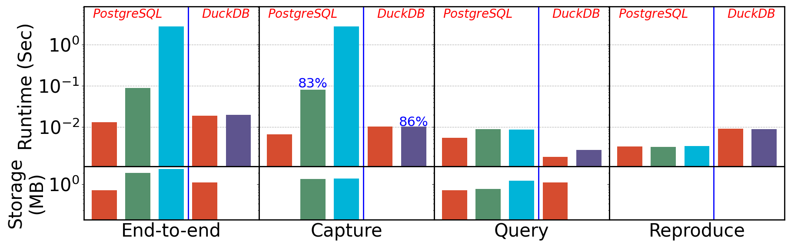
  

## 1% lineage

  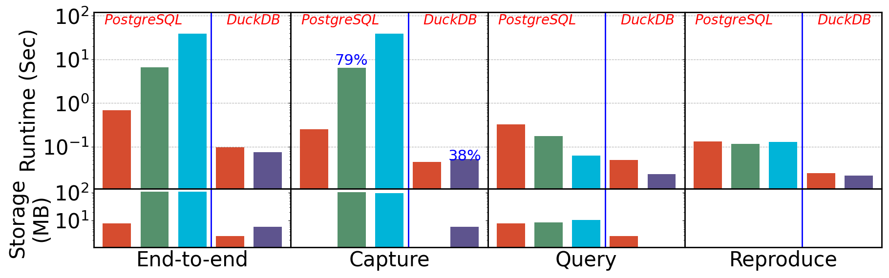
  

## 20% lineage

  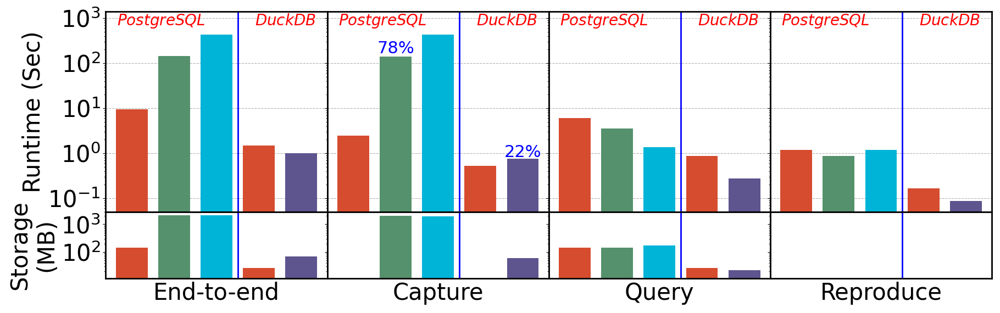
  

# Provenance Polynomials

  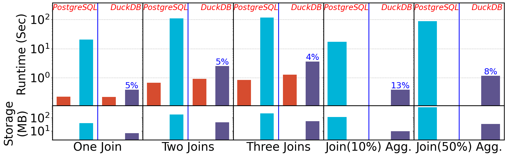
  

# Vary Per result provenance size

  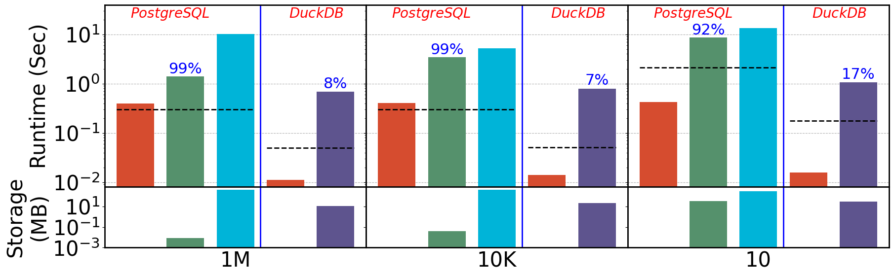
  

# Factorization

  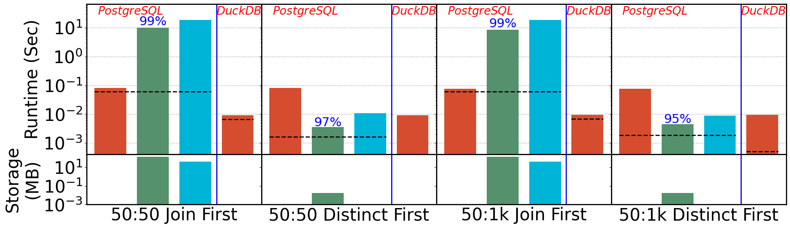
  

# Complex join Subqueries

  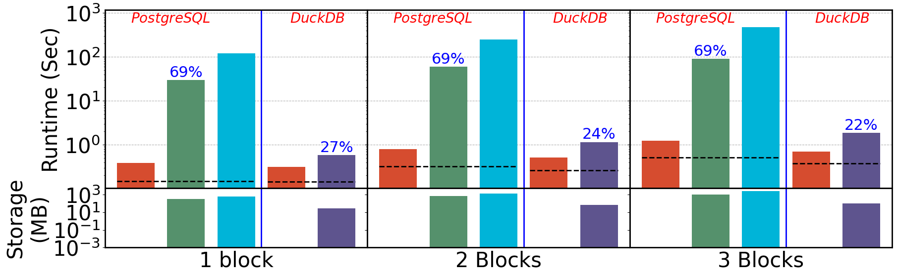
  

# Where subqueries

  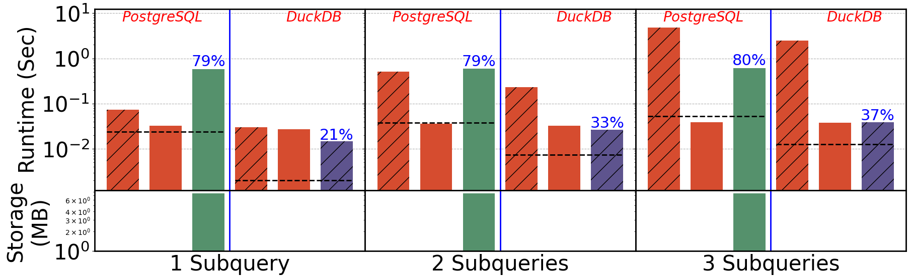
  

# Intermediate TopK

  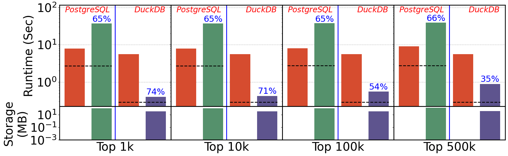
  

# Total Provenance

  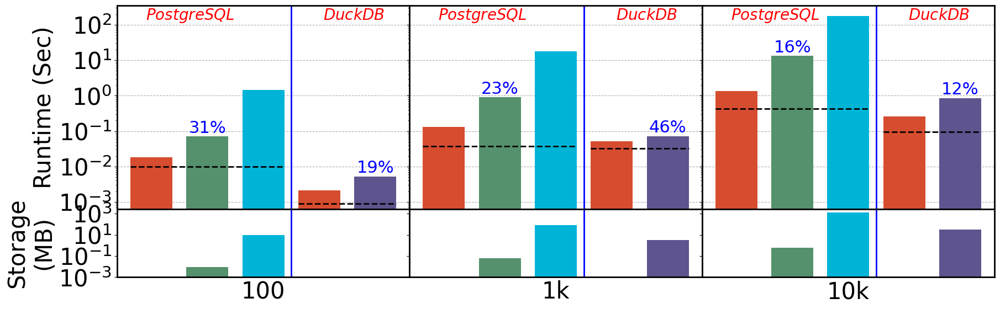
  

# Forward Debugging
## need provsql

  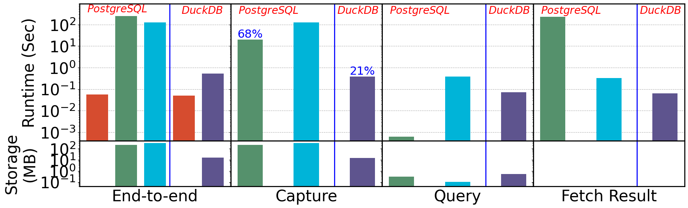
  

# What-If
## need provsql
